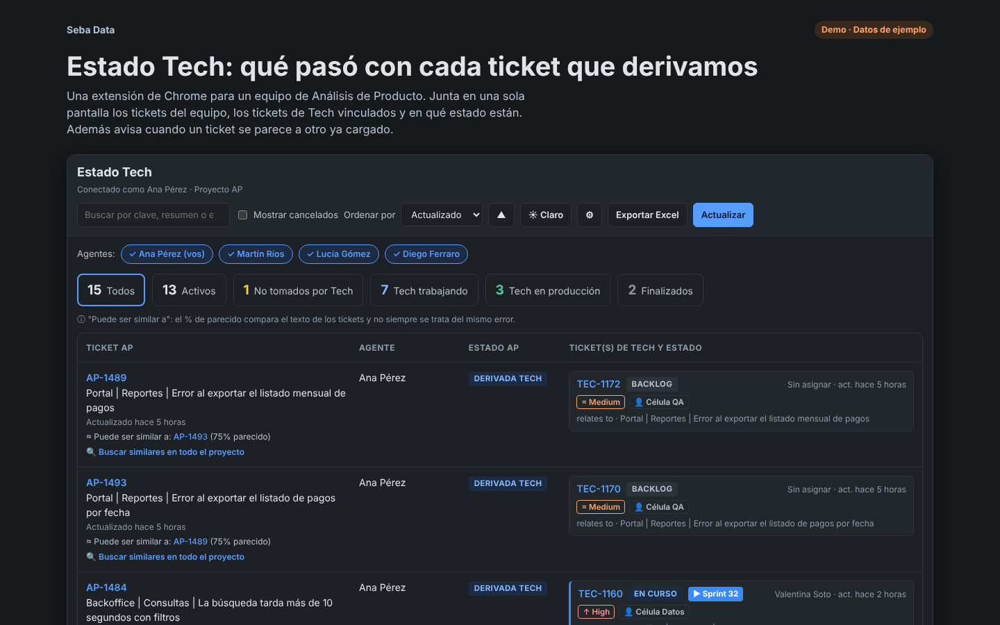

# Estado Tech · demo

**[Ver la demo en vivo](https://seba88arg.github.io/estado-tech-demo/)** · Datos de ejemplo

Extensión de Chrome que armé para el equipo de Análisis de Producto donde trabajo. Junta en una sola pantalla los tickets del equipo en Jira, los tickets de Tech vinculados y en qué estado están.

Este repositorio tiene una **demo con datos inventados**. Muestra cómo se ve y cómo se usa la herramienta, pero no se conecta a ningún Jira. El código de la extensión real es de uso interno y no está publicado.

## El problema

El equipo deriva tickets a Tech, y Tech los toma en proyectos distintos según la célula. Para saber si un ticket ya estaba en producción había que abrirlo, seguir el vínculo y mirar el estado, uno por uno. Además, a veces el mismo error se cargaba dos veces.

## Qué hace

- Lista todos los tickets del equipo con sus tickets de Tech: estado, prioridad, célula, responsable y sprint.
- Contadores que también filtran: no tomados por Tech, Tech trabajando, en producción y finalizados.
- Avisa cuando un ticket se parece a otro según el texto, con el % de parecido, para no derivar dos veces lo mismo.
- Permite filtrar por agente, buscar, ordenar, mostrar los cancelados y exportar a Excel.
- Se instala como extensión de Chrome, sin servidores ni costos.

## Cómo funciona por dentro

- Usa la **API REST de Jira Cloud (v3)**. No lee la pantalla ni hace scraping del HTML: pide los datos en JSON a los mismos endpoints que usa la web de Jira.
- **No necesita token ni contraseña:** aprovecha la sesión de Jira ya iniciada en Chrome. Si el navegador no le pasa la sesión, hace la consulta desde una pestaña de Jira abierta, con el mismo resultado. Cada persona ve exactamente lo que puede ver en Jira.
- **Endpoints que usa:**
  - `/rest/api/3/myself`: verifica quién está conectado.
  - `/rest/api/3/search/jql`: trae los tickets del equipo con sus vínculos, y después los de Tech en tandas de 50.
  - `/rest/api/3/field`: detecta una sola vez qué campos personalizados son el Sprint y el Team.
  - `/rest/api/3/user/search`: busca agentes desde la configuración.
  - `/rest/api/3/issue/{clave}`: solo de respaldo, si un ticket no llega en la tanda.
- **Solo lectura:** no crea, no edita ni comenta tickets. No manda datos a ningún servidor externo; en el almacenamiento local de la extensión guarda solo la configuración y la última carga.

## Resultado

Hoy la usa todo el equipo: 6 personas ven en una sola pantalla qué está listo para cerrar, qué sigue en Tech y qué todavía nadie tomó.

## Stack

JavaScript · Extensión de Chrome · API REST de Jira Cloud v3 · JQL · Similitud de texto (Jaccard) · Exportación a Excel

---

Hecho por [Sebastián López](https://www.linkedin.com/in/sebadata) · [Seba Data](https://sebadata.netlify.app/)
